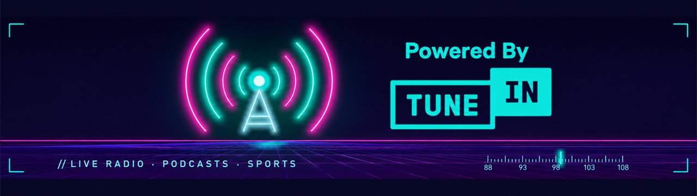

# TuneIn for Emby



TuneIn adds an audio channel to Emby with administrator-configured browsing,
scheduled category refreshes, station counts and live playback. Opening the
settings page or the channel root never crawls the TuneIn catalog by itself.

> [!IMPORTANT]
> Requires Emby Server **4.9.1.90+** stable or **4.9.2.7+** beta. Builds
> against MediaBrowser.Server.Core 4.9.1.90 and System.Memory 4.6.3. Do not
> copy dependency DLLs into Emby's plugin folder.

> [!WARNING]
> RC4 source is available for offline testing; RC4 has not been published as
> a GitHub release. Earlier local RC4 packages do not include every change in
> this source. Build the revision you intend to test. Back up Emby, including
> library metadata and TuneIn configuration, before testing.
>
> Discovery-time imports are experimental and off by default. Their optional
> changed-token bridge can misidentify unrelated work; real-server testing of
> changed-token behavior remains outstanding. See
> [Discovery-time imports](#discovery-time-imports-experimental) for the risks
> and prerequisites.

## Contents

- [Features](#features)
- [Install](#install)
- [Configure browsing](#configure-browsing)
- [Refresh the catalog](#refresh-the-catalog)
- [Status and diagnostics](#status-and-diagnostics)
- [Control Panel colors](#control-panel-colors)
- [Clean up the library](#clean-up-the-library)
- [Artwork](#artwork)
- [Playback](#playback)
- [Security](#security)
- [Limits and recovery](#limits-and-recovery)
- [Build and test](#build-and-test)
- [License](#license)

## Features

- **Configured browsing:** choose categories and saved selections in a
  lockable, theme-aware Control Panel. Navigation IDs are signed.
- **Resilient refreshes:** refresh one category or all of them, manually or on
  a schedule, with pacing, checkpoints, bounded retries and partial imports.
- **Status and diagnostics:** per-category outcomes, station counts, live
  progress, administrator-only refresh reports and reviewed shareable diagnostic
  packs with browser-assisted GitHub reporting.
- **Library maintenance:** preview and clean one station, one category or the
  whole TuneIn library.
- **Playback:** a validated relay by default, including TuneIn's separate
  introductions and stalled-stream handling, with optional direct HLS playback.
- **Artwork:** built-in default category artwork, plus optional category, music
  genre, language and location packs from
  [EmbyTuneInArt](https://github.com/oconnoradv/EmbyTuneInArt).

### Future enhancement possibilities

- Control Panel localization that follows the user's Emby language
  ([#10](https://github.com/oconnoradv/EmbyTuneIn/issues/10)).
- Establish reliable import identity when Emby changes nested-request cancellation
  tokens ([#11](https://github.com/oconnoradv/EmbyTuneIn/issues/11)). The
  experimental opt-in bridge is not a reliable identity and does not resolve this.
- Distinguish legitimate pagination transitions from genuine selected-node
  escapes, using representative source/target examples
  ([#13](https://github.com/oconnoradv/EmbyTuneIn/issues/13)). Five observed
  podcast continuations are supported with the unchanged `p:topic` filter:
  `g3403` to `c100001371`, `g3422` to `c100000625`, `g3428` to `c100000892`,
  `g3429` to `c100000887` and `g3430` to `c100000886`.
  Unverified transitions remain incomplete. Genre
  continuation links can retain an unchanged language-only filter, not just station/show
  filters, in both selected-language and All modes. Known aliases still cannot
  be used by a different genre; other transitions remain evidence-gated.
  Incomplete-discovery protection remains enabled.
- Review whether an empty category needs an explicit incomplete-discovery policy
  exception beyond the existing exclusions option
  ([#14](https://github.com/oconnoradv/EmbyTuneIn/issues/14)). The basic partial
  import behavior is implemented; any cleanup/protection bypass needs a
  demonstrated unmet need and separate policy approval.
- With a compatible baseline, overlap importing a completed category with
  discovery of the next category, while keeping imports serialized and
  preserving snapshot isolation, verification and interruption recovery
  ([#15](https://github.com/oconnoradv/EmbyTuneIn/issues/15)). Deferred.
- Investigate rejected By Location filter values and support only verified
  legitimate formats ([#16](https://github.com/oconnoradv/EmbyTuneIn/issues/16)).
  Known NUL-encoded hash alphabet markers are recovered, including regional
  `:country` indexes. Duplicate filters, arbitrary suffixes and literal
  backslash escape sequences remain rejected.
- Evaluate an optional resettable HTTP 429 streak wait budget
  ([#17](https://github.com/oconnoradv/EmbyTuneIn/issues/17)). A policy proposal,
  not a current defect; existing per-refresh budget behavior remains unchanged.
- Investigate historically reported playback cooldown test flakiness if a
  failure can be reproduced under busy parallel execution
  ([#18](https://github.com/oconnoradv/EmbyTuneIn/issues/18)). Latest repeated runs
  passed; no speculative playback change is planned.
- Complete remaining real-Emby keyboard, screen-reader, touch, theme and
  host-compatibility checks
  ([#19](https://github.com/oconnoradv/EmbyTuneIn/issues/19)). Record practical
  findings and limitations without claiming WCAG conformance.
- Extend diagnostic packs to playback, artwork and dashboard modules
  ([#20](https://github.com/oconnoradv/EmbyTuneIn/issues/20)). Deferred; the first
  implementation covers discovery, refresh and imports only.

## Install

Build the source revision you intend to install using [Build and test](#build-and-test).
The Release DLL is written to
`MediaBrowser.Plugins.TuneIn\bin\Release\netstandard2.0\MediaBrowser.Plugins.TuneIn.dll`.
These instructions describe the current source, not a separately published
release or download package.

1. Stop Emby. Back up the plugin DLL, the TuneIn configuration,
   `TuneIn.refresh.xml` (with its `.discovery` and `.recovery` sidecars) and
   `tunein-fork-settings-lock.xml` if present. A full server backup also
   preserves library metadata for rollback.
2. Copy `MediaBrowser.Plugins.TuneIn.dll` into the plugins folder, replacing
   the existing DLL on upgrades. Keep one copy only.
3. Start Emby and reload the dashboard. If settings look stale, clear the
   client's cached page data.

### Verify the installed version

Beside **Global TuneIn Settings**, the Control Panel shows the running DLL's
assembly version. A short source commit is also shown when the build's
informational version contains one. Compare this with the DLL you installed;
an unexpected version can indicate that Emby is still loading an older copy.

### Upgrades and rollback

Keep the navigation signing key in the configuration private and keep it
across upgrades; replacing it invalidates existing item IDs. To roll back,
restore the previous DLL, configuration and refresh state together.

After upgrading from a build with different item-ID rules, run a full TuneIn
refresh to replace stale channel items. If a category refresh runs while Emby's
**Refresh Internet Channels** task is active, retry it after that task finishes.

## Configure browsing

For a first installation:

1. Open **Advanced → TuneIn** (or **Plugins → TuneIn → Settings**) as an
   administrator. Wait for refresh status to load and unlock settings if
   they are locked.
2. Leave **Enable TuneIn Station Filtering** checked and enable at least one
   category. Configure its required source or selections as described below.
3. Select **Save**. Saving locks the settings again but does not start a
   catalog crawl.
4. Follow the Control Panel's catalog setup checklist. Its read-only checkboxes
   update automatically, and the checklist remains visible until every step,
   including a complete initial baseline, is done. It reappears for setup or
   host requirements, such as a configuration requiring an upgrade or a missing
   channel registration, not merely because settings were unlocked or edited.
   Once setup is complete, actual edits show a yellow reminder to save and,
   for catalog changes, run Catalog Refresh afterward.
   On wide screens it stays beside the control panel; on smaller screens it
   appears above it. Open
   **Catalog Refresh** and select **Refresh all enabled categories** to build
   the initial baseline. With multiple categories enabled, individual refresh
   buttons remain disabled until a complete baseline is established; a partial
   first discovery does not complete it.

The refresh controls remain unavailable until the filtering settings are
saved and at least one eligible category is enabled. A refresh also requires
Emby to have registered the TuneIn channel; if the checklist says it is not
registered yet, restart Emby and check that the plugin is installed. This is
separate from configuration errors. The plugin starts the channel import
itself; running Emby's **Refresh Internet Channels** scheduled task first is
not required.

### Choose categories and stations

| Category | Configuration |
| --- | --- |
| Music, By Language, By Location | **All**, or **Selected only** with saved choices |
| Local Radio | At least one enabled saved city/region, or coordinates (`lat,lon`) |
| Talk, Sports, Podcasts | **All**, or **Selected only** topics |
| My Favorites | A TuneIn username |

- Every enabled **Selected only** category needs at least one valid saved
  choice. Local Radio's **Saved Cities & Regions** source always requires an
  enabled saved choice; an empty selection never falls back to worldwide
  continents, including configurations previously saved as **All**.
  My Favorites needs a username. Inline messages identify
  missing requirements before settings can be saved.
- Local Radio source values `regions`, legacy `cities`, and `coordinates`
  accept surrounding whitespace and any letter case. Unrelated settings saves
  preserve their existing spelling. A whitespace-only or unknown explicit source
  needs correction; it does not silently select regions or coordinates.
- **Station Selections** groups every selector. In **Selected only**, browse
  in the left column and **Add** choices (up to 100 per selector); saved
  choices appear in the right column. To remove choices, select
  **Select Items for Delete**, check them, and select **Delete Selected Items**.

### Settings lock and navigation

- **Settings lock:** the switch in the sticky control-panel header shows
  **Locked** (green) or **Unlocked** (red). Once settings have been saved,
  opening or reloading the control panel locks them; initial setup remains
  editable before the first save. Saving locks settings again; unlocking opens
  TuneIn Station Filtering. The adjacent information icon explains the lock.
  Optional-check preferences also require
  manual unlocking and cannot change the lock themselves. Catalog refreshes
  (including scheduled refreshes), cleanup, **Backup Emby**, and artwork
  installation lock settings on the server before starting; settings remain
  locked afterward. Edits and unlocking are blocked while those operations
  run, including an active Emby Server Backup detected through Scheduled Tasks.
  A failed save can leave settings locked; check status and unlock before retrying.
- Station Filtering can be expanded while settings are locked for read-only
  review. Expanding it opens **Audio Categories** and **Station Selections**;
  either group can then be collapsed independently.
  Saving changed filtering settings opens **Catalog Refresh**.
  **TuneIn Library Refresh** stays expanded inside it; only the outer
  Catalog Refresh section can be collapsed.
- The control-panel header and notices remain visible while scrolling when they
  fit within 45% of the viewport height. Longer notices and short or zoomed
  viewports use normal page scrolling instead, without a separate header scrollbar.
  The plugin version appears beside Global TuneIn Settings.

### Browsing scope and upgrades

- By Language follows TuneIn's Music, Talk and Sports groups for each
  language, narrowed to your selected Music genres when set.
- Browsing and playback enforce the saved scopes. Changing a scope
  invalidates affected item IDs; return to the channel root after saving.
- Configurations older than schema version 1 keep their username and
  coordinates but must be saved again to enable browsing.

### Global settings

- **Hide the individual genre folders** hides genre shortcuts in Local Radio,
  By Location, Talk, Sports and Podcasts. Music and By Language are unaffected.
- **Import valid results when catalog entries are skipped** allows
  [partial results](#partial-results). On by default.

### Advanced settings

**Advanced Settings** is collapsed by default.

Settings are grouped by discovery, request pacing, import behavior, and
playback and diagnostics. Select **Settings guide** beside the section heading
for an included plain-language explanation. Hover over an information icon or select it for
details; press Escape to close it and return focus. Critical warnings remain visible.
Defaults apply to new configurations; existing saved values are not replaced.

| Setting | Range | Default |
| --- | --- | --- |
| Max Station Count (unique stations per top-level category) | blank (unlimited) or 5–10,000 | 500 for new configurations |
| Traversal depth limit (category root is level 0) | 3–50 | 10 |
| API request interval | 1–30 seconds | 3 |
| Maximum rate-limit wait per refresh | 5–60 minutes | 15 |
| Consecutive HTTP 429 retries | 0–10 | 6 |
| Discovery deadline | 2–48 hours | 12 |
| Import deadline | 1–100 hours | 24 |
| Import during category discovery | on/off | off |
| First pass after entries | 1–10,000 | 50 |
| Minimum new entries between passes | 1–10,000 | 500 |
| Minimum growth between passes | 1–100% | 25% |
| Minimum time between passes | 1–3,600 seconds | 45 |
| Maximum discovery-time passes per category | 1–100 | 100 |
| Enable catalog identity diagnostics | on/off | off |
| Allow direct HLS playback | on/off | off |

#### Discovery limits

Existing discovery deadlines or station limits outside these ranges must be
corrected before refreshing or saving. They are not silently changed.
Reaching the station count or depth limit produces a **Limited** result that
can still be imported.

#### Discovery-time imports (experimental)

By default, staged imports require the exact import cancellation token. If Emby
changes it for a nested request, verification can fail and recovery is required.

**Requirements and acknowledgement**

**Import during category discovery** is off by default. To enable it:

1. Accept the risk notice. Saving this option also enables the experimental
   changed-token bridge for staged imports. Existing installations with the
   option enabled must accept the new risks before the bridge can be used.
2. Enable **Import Valid Results when catalog entries are skipped**. If it is
   off, the notice offers to enable both options. This also permits partial
   results during ordinary refreshes.
3. Save settings. The plugin records and logs the acceptance.

Turning off partial imports later stops early imports, but the bridge remains
enabled until discovery imports are turned off. Disabling and re-enabling
discovery imports requires acknowledgement again.

**Risks and testing**

**Back up Emby, including library metadata and TuneIn configuration, before testing.**

The bridge uses inherited execution context, not a reliable import identity:
unrelated TuneIn work inheriting that context can read staged entries and make
verification appear complete even if Emby's traversal missed folders. Entries
may be incomplete or incorrect, and playlists, favorites, history and other
references may be affected even after rebuilding TuneIn. Emby writes library
changes to its database; corruption has not been demonstrated, but database
and broader server compatibility are unverified. Additional import passes can
increase shared server load. The bridge may still fail if context is not carried.
Limited isolated Emby checks used the original token and did not verify
changed-token behavior; real-server verification remains outstanding.

#### Catalog identity diagnostics

**Catalog identity diagnostics** add aggregate catalog comparisons and
unserved-folder details to logs and reports. Enable them only while
troubleshooting.

#### Direct HLS playback

See [Security](#security) before enabling **Allow direct HLS playback**.

## Refresh the catalog

In **Catalog Refresh**, select **Refresh** beside a category or
**Refresh all enabled categories**. Opening the panel only reads status.

### How imports run

With a compatible saved baseline, refresh-all imports each changed completed
category before discovering the next one. Without that baseline, the shared
import waits for the selected categories to be discovered. Import and discovery
do not run in parallel. A compatible single-category refresh imports only that
category.

Optional discovery-time imports can publish earlier when partial imports are
enabled, pausing discovery during each import. After the first pass, another
requires both the configured elapsed time and the greater of the configured
entry count or percentage growth. The per-category pass limit and pacing are
retained across interruption retries. These imports retain saved entries and
remain subject to import verification and recovery.

### Ordering and retained stations

- **Refresh all** processes interrupted work first, followed by enabled
  categories in this order: My Favorites, Local Radio, Music, By Language,
  By Location, Talk, Sports and Podcasts.
  The library refresh list follows that order and highlights the current
  category while it is being refreshed. Channel folders and staged imports use
  the same category order. A shared multi-category import has no single
  highlighted row.
- Refresh merges new stations into the verified saved entries. A station
  missing from a discovery is not deleted; removing a saved filter does
  remove entries outside the new scope.
- Unchanged catalogs skip import unless reconciliation is needed.

### Queue and recovery

- One refresh runs at a time, with up to two waiting. **Cancel refresh**
  stops the run and clears the queue.
- Emby imports are not transactional. After an interrupted import, the next
  refresh supplies the complete catalog for reconciliation.

### Schedules

Choose **Off**, **Every 6 hours**, **Every 12 hours**, **Daily**, **Weekly** or
**Every 30 days** beside a category and **Save**. Schedules are off by default,
share the manual queue, and do not replay missed runs. The plugin does not
run schedules until the first baseline is complete, and does not create or
change Emby Scheduled Tasks. If Emby's **Refresh Internet Channels**
task also has triggers, a dialog warns that both will run.

### Partial results

Malformed links from TuneIn can be skipped without abandoning valid siblings.
With partial imports enabled, valid results are imported and compatible saved
branches are kept; the result is marked **Partial**. This applies to both
individual-category refreshes and **Refresh all**, including per-category
imports with a compatible baseline and discovery-time imports switched off.
With partial imports disabled, an incomplete category is left unchanged;
compatible refresh-all runs can still apply completed sibling categories.
Cleaned categories still require complete discovery before they can be rebuilt.
Unsafe destinations,
scope violations, unrecovered failures, timeouts and budgets are never
overridden.

TuneIn **More Stations** and **More Shows** pages are followed and their
stations are listed directly in the linking folder. Unexpected jumps to other
categories are skipped and reported as partial. Pages under a language retain
the selected language filter.

## Status and diagnostics

Section and row colors show the outcome (see
[Control Panel colors](#control-panel-colors)). Live metrics show elapsed
time, progress, pages fetched and, during import, folders served.

### Station counts

| Count | Meaning |
| --- | --- |
| Available (filtered) | Distinct stations found by the latest discovery |
| In Emby | Distinct stations present in the category's Emby folder |
| Not in latest discovery | Distinct Emby stations absent from the latest complete comparable discovery |

Hover a count for its check time. Failed inventory checks show **last known**.
The comparison is unavailable when discovery is partial or limited, the inventory
cannot be checked, or no comparable discovery is available. It does not imply
that a station should be deleted.

### Refresh details and private log

**Refresh details and private log**, below the category list, contains provider
requests, cache replays, rate-limit retries, checkpoint resumes and skipped
links by reason, along with import details.

In that section, **Retrieve refresh log** gives an administrator-only report (up to 64 KB) for
failed, timed-out or partial refreshes: outcome, skip counts and up to 100
skipped-link examples. Usernames, coordinates, tokens, provider responses and
signed IDs are omitted. Review reports before sharing; exception traces can
contain server details. Reports are kept in memory until the next refresh or
restart.

### Shareable diagnostic packs (Option 1)

Implemented for discovery, catalog refresh and imports
([#9](https://github.com/oconnoradv/EmbyTuneIn/issues/9)). Playback, artwork and
dashboard capture remain deferred.

1. In **Catalog Refresh > TuneIn plugin support (GitHub)**, choose whether to include
   public navigation details, then select **Capture redacted pack**. Only the
   latest refresh is available to capture; an active run produces a point-in-time
   snapshot without stopping it. Starting another refresh or restarting Emby
   removes the uncaptured context, not saved packs.
2. Select a saved pack and inspect its exact JSON preview. **Download JSON pack**
   saves that revision locally. The private refresh log is not part of the pack.
3. Inspect the resolved repository and issue title/body, then check the review
   confirmation and select **Open GitHub issue draft**. Sign into GitHub, attach
   the downloaded pack and submit the issue yourself. The plugin does not create
   an issue, upload the pack, store GitHub credentials or send reports in the
   background. GitHub displays sign-in, repository/Issues availability and
   submission errors; the plugin cannot confirm submission across origins.
   The plugin validates the reviewed revision/destination before opening a tab.
   If your browser blocks it, use the reviewed GitHub draft link shown below
   the button; this normal link opens in a new tab without an opener or referrer.

#### Pack contents and privacy

Packs use a versioned, allowlisted structure: plugin/host assembly versions,
UTC run times, outcome/phase/error codes, numeric/boolean discovery and import
settings, request/retry/timeout counts, import refresh depth/restriction and
consumption counts, and bounded, deduplicated rejection examples. Delivery of a
listing is not confirmation of Emby database writes. Capturing never changes
catalog membership, import verification or dirty/recovery state.

Public navigation is **off by default**. When enabled, only trusted public
catalog IDs and recognized navigation values are retained. Unsupported filters
contribute a character-class/length shape rather than their raw contents;
omitted/duplicate/truncated details are counted. Arbitrary URLs, usernames,
coordinates, favorites, stream URLs, private labels/paths, raw exceptions,
provider responses and complete configuration are not copied. Public catalog
IDs can still reveal regions/interests: review before sharing, and do not treat
redaction as guaranteed anonymity.

#### Storage and deletion

Saved packs live in `PluginConfigurationsPath\TuneInDiagnostics`: at most
**5 packs**, **256 KiB each**, **1 MiB total**. They expire after **7 days**;
expired/oldest packs and interrupted temporary captures are removed on the next
diagnostics operation. They inherit Emby's configuration-directory permissions
on Windows; Unix additionally uses owner-only directory/file modes. Keep the
configuration directory private. **Delete selected pack** requires its current
revision; **Delete all packs** can also clear unreadable/corrupt saved packs.
Deletion never removes downloaded copies or content already shared on GitHub.
Storage and reporting errors remain explicit; they do not trigger uploads.

#### Hidden reporting destination

The optional `DiagnosticsIssueRepository` configuration property accepts a
GitHub `owner/repo`, not a URL or another host. It has no dashboard settings
control. When absent or empty, it follows the build default, currently
`oconnoradv/EmbyTuneIn`; the effective default is not saved as an override.
Maintainers can therefore change an upstream build's default without pinning
existing installations to the fork.

For an explicit override, stop Emby, back up the plugin configuration and set,
for example, `<DiagnosticsIssueRepository>MediaBrowser/TuneIn</DiagnosticsIssueRepository>`
only when that repository accepts these reports, then restart Emby. Remove the
override to follow the build default again. The resolved repository is always
shown before sharing. A changed destination or pack revision requires fresh
review; invalid values disable reporting with an error but do not prevent
refreshes, local capture or download. This property does not change catalog IDs.

## Control Panel colors


| Color | Scenario |
| --- | --- |
| Green | Saved Global Settings, configured Station Filtering and successful or **Limited** refreshes, shown while collapsed; **Locked** label; imported, unchanged or limited category rows; selected station matches |
| Orange | **Advanced Settings** (always); partial refreshes and partial or incomplete category rows |
| Red | Refresh errors and failed or timed-out category rows; **Unlocked** label |
| Amber | **Refreshing** and **Maintenance is active** badges (pulsing unless reduced motion is on); configuration-required, deletion and cleanup notices |
| Yellow | First-run Catalog Refresh prompt, unsaved-settings reminders, validation and error notices |
| Theme surface | Expanded sections and settings not yet saved |

## Clean up the library

**Maintenance → Clean Up Library Folders** removes TuneIn entries from Emby.
Cleanup can't be undone. **Backup Emby** starts the **Emby Server Backup**
task, which needs Emby's **Backup & Restore** plugin; wait for it to succeed.

1. Choose **All categories**, one category, or **One station entry** (search
   by name, or paste an Emby item ID or URL).
2. Select **Preview cleanup** to count verified entries.
3. Confirm the backup and the removal within five minutes.

Only signed TuneIn entries are removed; the channel root, settings and media
files are never touched. **Stop cleanup** stops after the current group.
Refreshes and settings changes wait until cleanup ends. Enabled categories
return on the next refresh; disable a category to keep it absent.

## Artwork

Category folders use bundled artwork unless a matching category card is
installed. The top-level TuneIn library item always uses bundled artwork with
the **Powered by TuneIn** mark. Refreshing a category updates its artwork.

Music genre, language and location folders use their category artwork unless
matching cards are installed. Optional packs from
[EmbyTuneInArt](https://github.com/oconnoradv/EmbyTuneInArt) replace or
supplement the built-in artwork. Obtain or create a pack that meets the
[canonical schema 2 format](#canonical-artwork-pack-format-schema-2) below.
Legacy packs cannot be uploaded.

### Automatic artwork checks

Expand the collapsed **Custom Artwork Packs** section to manage packs. The
**Upload Artwork Pack** and **Run Checks Now** buttons sit together, with
**Skip automatic artwork pack status checks** and its information icon directly
below. Activate the icon for details. The option controls only automatic scans
of artwork pack manifests and image hashes. Authentication, settings and
operation locks, channel registration, refresh readiness and artwork upload
validation remain live and are not bypassed.
After settings are saved and a category refresh succeeds without partial or
limited results, the option becomes available. Existing installations need one
new successful refresh because older checkpoints cannot prove completion.

The preference is saved on the server and shared across browsers. Unlock
Settings to change it; it saves immediately. Skipped scans leave results stale
or unavailable, and automatic scan results are cached for up to five minutes.
Changing this preference only shows feedback in the artwork section; it does
not require a catalog refresh or display a catalog-refresh reminder.
The panel shows the last checked time. Use **Run checks now** for an immediate
scan without unlocking, or leave automatic checks enabled to refresh status on
the normal schedule. Manual artwork changes appear on the next scan or when
checks are run on demand.

### Upload and install

Artwork packs are verified before installation. Future enhancements do not
change the current safety policy.

#### Prepare and verify

In the administrator settings page, **Custom Artwork Packs** shows the name,
image count and server folder for each scope. Scroll the table horizontally to
see long paths on narrower screens. Unlock settings before uploading;
the server rejects uploads and installation while they are locked. Installation
locks settings again. Select **Upload Artwork Pack**
and choose a ZIP from the computer running the browser. Confirm **Verify pack**
to upload it. Once the ZIP has been received, the upload request returns and
the server validates the entire archive and scans the staged files in the
background; the page polls for progress and the confirmation. This avoids
holding the upload response open during lengthy validation behind a reverse
proxy. Proxies must still allow the ZIP's size and upload duration, and their
individual status requests must reach the server.

#### Confirm installation

Review the pack's name, scope, image count, scan status and replacement warning,
then confirm installation or cancel. Installation replaces the entire
existing scope, not just matching images. Uploads and installation are
serialized; an active TuneIn refresh or cleanup prevents activation. A failed
validation or replacement preserves the previous installation. Confirmation
expires after 30 minutes. If the page is left while validation runs, it attempts
to discard the completed staging; otherwise staging expires automatically.

#### Refresh affected categories

After installation, choose **Refresh now** or **Later**. No refresh begins
without that consent. **Refresh now** opens Catalog Refresh and moves keyboard
focus and the viewport there; blocked or failed starts are reported there and
in the artwork section. The prompt lists affected enabled categories: genres
affect both Music and Language, language cards affect Language, location cards
affect Location, and category cards affect their corresponding categories.
Refreshes use the existing controls and may be refused if work, readiness,
recovery or queue limits prevent starting them. Installation remains successful
even if a refresh cannot start.

### Canonical artwork pack format (schema 2)

#### Archive contents

The ZIP must contain a root `tunein-artwork.json` and the images explicitly
listed in it. Packs may also include `LICENSE.txt`, `Noto-OFL.txt`,
`README.txt`, `FLAGS-SOURCES.txt` and `flag-sources.json`; these must be nonempty
UTF-8 text, at most 1 MiB each, and are scanned, checked for changes and installed
with the pack. Flag provenance JSON is retained as informational text, not
interpreted or used to fetch files. All names are flat, ASCII, case-sensitive, with no
directories, other files, ZIP comments or extra fields. ZIP32 stored or deflated entries are
accepted; encrypted, multi-volume and ZIP64 archives are not. Duplicate or
case-colliding entries, links, traversal, absolute paths and network references
are rejected. Files must be JPEG (`.jpg`) or PNG (`.png`) with a lowercase
extension. Scripts, executables, shortcuts, HTML, SVG, nested archives and
other content are not accepted.

#### Manifest

Every scope and theme uses the same strict UTF-8 manifest, without a BOM.
Its exact required root fields are `schemaVersion` (integer, exactly 2),
`scope`, `packId`, `packName`, `theme`, `version` (strings), `imageCount`
(integer) and `images` (array). Every image has exactly the string fields
`id`, `file` and `sha256`. There are no optional manifest fields, null values,
scope-specific shapes or legacy fallbacks. Unknown and duplicate fields fail.
Descriptions, source details and flag attribution belong in the retained
notices, not extended manifest properties. Pack authors must preserve the
applicable license, font and source attribution in those allowed supplements.
The plugin allows these five exact supplementary names;
it never follows URLs or treats provenance as executable instructions.

`packId` is a case-preserving ASCII slug matching
`[A-Za-z0-9][A-Za-z0-9._-]{0,127}`. `version` is a case-preserving content
version matching `[0-9A-Za-z][0-9A-Za-z.+_-]{0,63}`; it is not the schema or
plugin version, and installation does not impose version ordering. Custom
pack IDs and versions are retained for every scope, including categories.
`imageCount` must equal the number of records and the exact ZIP image inventory.
Each SHA256 is the 64 hexadecimal digits of the actual image bytes. For
example, copy this repository's
`MediaBrowser.Plugins.TuneIn\Images\tunein-talk.png` to `talk.png` in the ZIP
with this manifest:

```json
{
  "schemaVersion": 2,
  "scope": "categories",
  "packId": "my-category-cards",
  "packName": "My category cards",
  "theme": "Custom",
  "version": "1",
  "imageCount": 1,
  "images": [
    { "id": "talk", "file": "talk.png", "sha256": "c40ef8877643bc6ae6cc4e9c514cb51ca900a2a02efe145df34fd287e7e7e03f" }
  ]
}
```

#### Scopes and image IDs

The scope is exactly one of `categories`, `genres`, `languages`, or `locations`.
Category IDs are `local`, `music`, `language`, `location`, `talk`, `sports`,
`podcast`, and `presets`. Genre IDs are `c` or `g` followed by a nonzero digit
and up to nine more digits; language IDs use `l`, and location IDs use `r`,
with the same numeric rule. Each filename is its exact ID plus `.jpg` or
`.png`; IDs and filenames cannot repeat, including case collisions. Pack names
and themes are 1–128 characters, trimmed, without controls, path separators, colons, `@`
or `www.`.

#### Size limits and validation

Limits are 768 MiB uploaded, 2 GiB expanded, 4 MiB manifest, 20,000 records,
16 MiB per image, 4,096 pixels per dimension and 16,777,216 pixels total.
The server's configured FFmpeg must decode each image; each decode is limited
to 30 seconds, scanning to 30 minutes, and the overall upload/processing to
45 minutes. Validation checks structure, hashes and decodability, but does not
guarantee images are malware-free.

#### Antivirus scanning

The server checks Microsoft Defender on Windows or `clamscan` in supported
standard installation locations; it does not install software, elevate
privileges, run arbitrary commands or send packs to an external scanning
service. Defender is used only when its service-account-readable settings show
antivirus running normally, cloud reporting disabled and automatic sample
submission disabled. Otherwise installation is blocked; the plugin does not
change server security policies. Defender output in an unexpected language or
format also fails closed. Each file's exclusion status must be verifiable by
the Emby service account and not excluded from scanning; Defender may deny this
check without sufficient existing permissions. Scanner errors, threats, timeouts and incomplete scans
block installation. If neither supported scanner is installed, the pack is
marked **Not scanned** and requires explicit approval before installation.
The browser's antivirus is not used.

#### Troubleshooting validation

If validation fails, check the manifest, exact filenames and hashes, ZIP
format, limits and server FFmpeg configuration. For scanner errors check its
availability, permissions, health and privacy settings on the Emby server.
Check the server logs for details. Packs with other metadata or files need
regeneration that meets this canonical schema 2 upload format;
simply renaming the ZIP is not sufficient. Do not remove required license or
provenance files to bypass validation.

### Manual installation

#### Legacy pack migration

Schema 1 and extended legacy packs are deprecated and cannot be uploaded.
Schema-1 uploads display a newer-pack notice, including older extended or
scope-less manifests, without offering installation.
Regenerate or download a canonical schema 2 pack; renaming an old ZIP or changing
only its schema number is insufficient. Existing legacy manifests or installed
cards without a manifest are shown as
**Legacy or unsupported pack**, not identified as validated schema 2 packs.
Reading status or rejecting an upload never deletes or rewrites existing
installed artwork. Existing file artwork can remain displayed during migration,
but is unsupported until replaced with a canonical pack.

Back up any custom cards before migration. Installing a new pack requires
explicit confirmation and replaces the entire selected scope using the existing
recovery safeguards. No automatic migration or release-pack regeneration occurs.

#### Installation directories

For manual installation, extract a canonical pack into the corresponding server directory:
`<Emby data>\plugins\configurations\TuneInArtwork\categories`, `genres`,
`languages`, or `locations`. Custom Artwork Packs reports the actual paths,
installed counts and canonical manifest identity; when hashes are available it also
distinguishes unchanged, replaced and added cards. The optional Cartoon example
loads from GitHub. Refresh the affected categories after manual installation.

Refreshing a category reapplies its installed pack artwork when the artwork
revision changes, even if an existing primary image is present. Reload the
client after the refresh if its tiles still show stale artwork or dimensions.

## Playback

By default, stations play through the plugin's server-loopback relay at
`/TuneIn/Playback/{item}/{attempt}` rather than giving Emby the station URL.
The explicit **Allow direct HLS playback** option is an exception.

- **Introductions:** for TuneIn's recognized introduction
  (`tunein-ondemand.cdnstream1.com/multi_bump_sonic_pre_pre.mp3`), the relay
  plays it and then one working live stream as a single item. Emby's FFmpeg
  decodes both to 48 kHz stereo PCM, which needs FFmpeg and adds some CPU.
- **Other stations** are relayed as-is; any `audio/*` stream type is accepted.
- **Alternatives:** if a stream can't be opened, the next advertised stream is
  tried. M3U and PLS playlists, including nested ones, are supported.
- **HLS:** stations that offer only HLS (`.m3u8`) streams need
  **Allow direct HLS playback**. When HLS and other streams are both offered,
  the other streams are used.
- Requests send an `EmbyTuneIn/<version>` User-Agent. Legacy SHOUTcast
  (`ICY 200 OK`) servers are supported.
- Saving settings stops only streams whose station is no longer allowed.
- Stalled reads time out after 60 seconds.

## Security

- **Relay connections:** each upstream connection is resolved, checked and pinned
  to a public internet address. Loopback, private, link-local, multicast,
  reserved, documentation and embedded private (IPv4-mapped, 6to4) addresses
  are refused. This also covers redirects and DNS rebinding. No proxy is used.
- **Redirects** are followed manually (up to four). HTTPS can't downgrade to
  HTTP, and TuneIn API requests can't leave their origin.
- **Direct HLS playback** lets Emby fetch HLS streams without these checks.
  Leave it off unless you need an HLS-only station on a trusted network.
- **Relay endpoint** accepts loopback requests only and uses one-use,
  unguessable handles that expire after 30 seconds.
- **Parsing:** XML responses prohibit DTDs and external entities; playlists
  and responses are size-limited.
- **Configuration and logs:** the navigation signing key stays server-side.
  Shareable diagnostic packs use an allowlisted export rather than copying the
  private refresh log. Private logs/reports can contain server details and must
  be reviewed separately before sharing.

## Limits and recovery

| Limit | Value |
| --- | --- |
| Catalog cache per refresh | 60,000 pages, 640 MiB |
| Discovered category | 1,000,000 items, 1 GiB estimated |
| Catalog HTTP response | 90 seconds |
| Concurrent discovery requests | Up to 4, sharing request spacing |
| Consecutive HTTP 429 retries | 0–10, default 6; resets after a successful catalog page (cooldowns of 30, 60 and then 120 seconds) |
| Rate-limit wait per refresh | 5–60 minutes, default 15 |
| Automatic interruption retries | 3 per refresh |
| Checkpoint resume window | Greater of 48 hours or the discovery deadline plus 24 hours, measured from discovery start |
| Playlist | 256 KiB, 8 entries, 4 nested levels |
| Playback resolution | 30 seconds each for queueing, opening and playlist reads |

- **Rate limits:** TuneIn's `Retry-After` is honored. Rate limiting doubles
  the request interval (up to 30 seconds) until requests succeed again. If a
  required delay exceeds the remaining refresh wait budget, the refresh fails
  rather than retrying early.
- **Timeouts** drain active work and stop without retrying. A manual refresh
  can reuse saved discovery pages within the checkpoint resume window.
- **Interruptions** (I/O failures, HTTP 5xx other than 504) are retried up to
  three times with fresh deadlines. Invalid data, scope changes and manual
  cancellation are not retried.
- **Restarts** never start a refresh. Only a manual request or a due schedule
  starts work; queued requests are not restored.
- **Import recovery replays the full category.** Emby's
  `IChannelManager.RefreshChannelContent`
  gives no per-folder commit acknowledgement, so imports can't resume halfway.
- Large refreshes can need substantial memory and disk: checkpoints up to
  900 MiB and saved catalog state up to 1 GiB.

## Build and test

```powershell
dotnet build MediaBrowser.Plugins.TuneIn\MediaBrowser.Plugins.TuneIn.csproj -c Release
dotnet test MediaBrowser.Plugins.TuneIn.sln -c Release
node --test MediaBrowser.Plugins.TuneIn.Tests\configPage.test.cjs
```

Tests need the .NET 8 SDK and Node.js. Set `TUNEIN_TEST_FFMPEG` to an FFmpeg
executable to include the real decoder tests; they are skipped otherwise.
Assembly and file versions come from the project or explicit build properties;
a locally versioned DLL does not imply a corresponding published release.

Tests that replace process-wide artwork directories belong to the
`Artwork globals` nonparallel collection, so other artwork readers cannot
observe their temporary paths. Other test collections retain normal parallel
execution.

### Live-server and accessibility checks

Automated tests don't prove live Emby behavior. Before release, test on a
backed-up server: settings and selectors, full and single-category refreshes,
schedules, interrupted imports, cleanup and stop, and playback (including
introductions and changing settings during playback).

Accessibility review is not a WCAG 2.2 AA conformance claim. The periodic banner
honors reduced-motion preferences but has no separate pause control; an accessible
pause or hide option remains recommended. Real-Emby keyboard, screen-reader,
touch and theme checks remain tracked in
[#19](https://github.com/oconnoradv/EmbyTuneIn/issues/19).

## License

Based on [MediaBrowser/TuneIn](https://github.com/MediaBrowser/TuneIn) and
distributed under [LICENSE.md](LICENSE.md).
See [THIRD-PARTY-NOTICES.txt](THIRD-PARTY-NOTICES.txt). The DLL embeds both
documents; include the documents alongside it when redistributing.

The plugin reads TuneIn's OPML/XML responses directly and does not bundle
HtmlAgilityPack.
