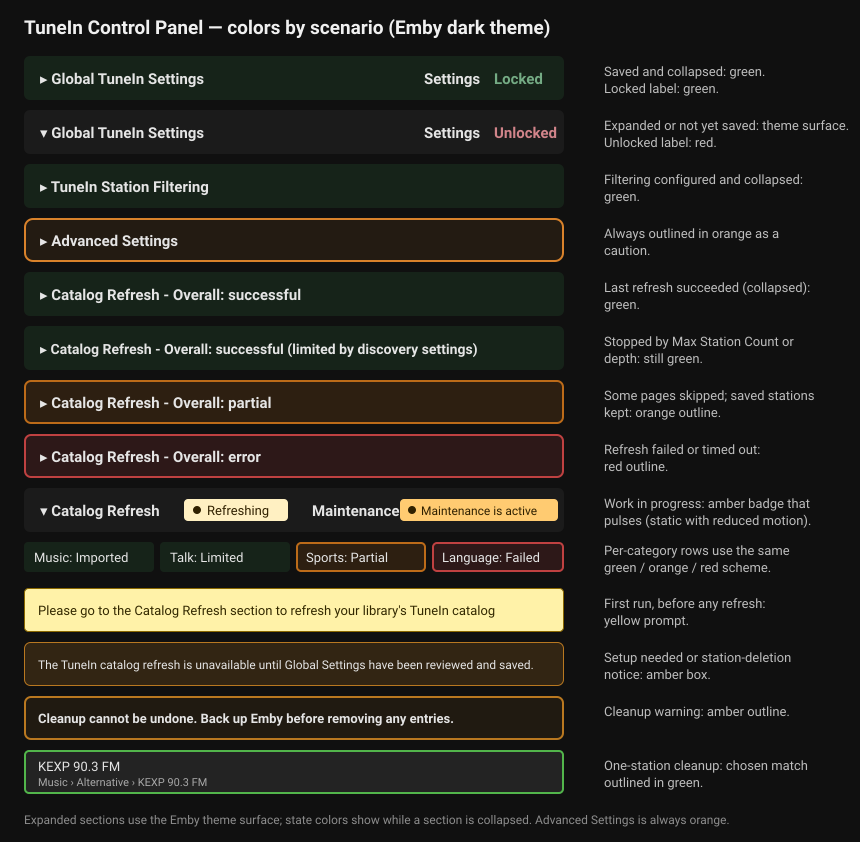

# TuneIn for Emby


TuneIn adds an audio channel to Emby with administrator-configured browsing,
scheduled category refreshes, station counts and live playback. Opening the
settings page or the channel root never crawls the TuneIn catalog by itself.

> [!IMPORTANT]
> Requires Emby Server **4.9.1.90+** stable or **4.9.2.7+** beta. Builds
> against MediaBrowser.Server.Core 4.9.1.90 and System.Memory 4.6.3. Do not
> copy dependency DLLs into Emby's plugin folder.

## Contents

- [Features](#features)
- [Install](#install)
- [Configure browsing](#configure-browsing)
- [Refresh the catalog](#refresh-the-catalog)
- [Status and diagnostics](#status-and-diagnostics)
- [Control Panel colors](#control-panel-colors)
- [Clean up the library](#clean-up-the-library)
- [Artwork](#artwork)
- [Playback](#playback)
- [Security](#security)
- [Limits and recovery](#limits-and-recovery)
- [Build and test](#build-and-test)
- [License](#license)

## Features

- **Configured browsing:** choose categories and saved selections in a
  lockable, theme-aware Control Panel. Navigation IDs are signed.
- **Resilient refreshes:** refresh one category or all of them, manually or on
  a schedule, with pacing, checkpoints, bounded retries and partial imports.
- **Status and diagnostics:** per-category outcomes, station counts, live
  progress and administrator-only refresh reports.
- **Library maintenance:** preview and clean one station, one category or the
  whole TuneIn library.
- **Playback:** a validated relay for every station, including TuneIn's
  separate introductions, with stalled-stream handling.
- **Artwork:** bundled category artwork and optional category, music genre, language and location artwork packs.

Planned: Control Panel localization that follows the user's Emby language.

### Future enhancement possibilities

- Add an interactive GUI in Global Settings to facilitate loading location,
  language and genre image packs.

## Install

Download the
[music refresh resilience RC2](https://github.com/oconnoradv/EmbyTuneIn/releases/tag/v1.2.8-music-refresh-resilience-rc.2).
The assembly version is **1.2.8.0**. `build-info.json` identifies the source
commit and `SHA256SUMS.txt` verifies the files.

1. Stop Emby. Back up the plugin DLL, the TuneIn configuration,
   `TuneIn.refresh.xml` (with its `.discovery` and `.recovery` sidecars) and
   `tunein-fork-settings-lock.xml` if present. A full server backup also
   preserves library metadata for rollback.
2. Copy `MediaBrowser.Plugins.TuneIn.dll` into the plugins folder, replacing
   the existing DLL on upgrades. Keep one copy only.
3. Start Emby and reload the dashboard. If settings look stale, clear the
   client's cached page data.

The top right of the Control Panel shows the running build, for example
**TuneIn plugin v1.2.8.0 (abcdef0)**. An older commit there means Emby is
still loading an older DLL.

Keep the navigation signing key in the configuration private and keep it
across upgrades; replacing it invalidates existing item IDs. To roll back,
restore the previous DLL, configuration and refresh state together.

### RC2 fixes

This republished RC2 keeps an unset Max Station Count blank and saves it as
`null`. Catalog browsing also recovers NUL-encoded `#` filters and ignores
TuneIn playback links instead of reporting them as malformed catalog links.
Staged imports are now bound to the Emby refresh token, so concurrent scheduled
channel refreshes and browsing cannot read from or interfere with a
category-scoped import. The fix was confirmed on a clean Emby server.
Artwork pack manifests now accept up to 4 MiB, allowing the published
Futuristic location pack to be identified without changing the pack.

After upgrading, run a full TuneIn refresh to replace any channel items saved
with stale configuration-bound IDs. If a category refresh runs while Emby's
**Refresh Internet Channels** task is active, retry it after that task finishes.

## Configure browsing

For a first installation:

1. Open **Advanced → TuneIn** (or **Plugins → TuneIn → Settings**) as an
   administrator. Wait for refresh status to load and unlock settings if
   they are locked.
2. Leave **Enable TuneIn Station Filtering** checked and enable at least one
   category. Configure its required source or selections as described below.
3. Select **Save**. Saving locks the settings again but does not start a
   catalog crawl.
4. Follow the first-refresh readiness checklist in the Control Panel. Open
   **Catalog Refresh** and select **Refresh all enabled categories** to build
   the initial baseline. With multiple categories enabled, individual refresh
   buttons remain disabled until a complete baseline is established; a partial
   first discovery does not complete it.

The refresh controls remain unavailable until the filtering settings are
saved and at least one eligible category is enabled. A refresh also requires
Emby to have registered the TuneIn channel; if the checklist says it is not
registered yet, restart Emby and check that the plugin is installed. This is
separate from configuration errors. The plugin starts the channel import
itself; running Emby's **Refresh Internet Channels** scheduled task first is
not required.

| Category | Configuration |
| --- | --- |
| Music, By Language, By Location | **All**, or **Selected only** with saved choices |
| Local Radio | All or selected cities/regions, or coordinates (`lat,lon`) |
| Talk, Sports, Podcasts | **All**, or **Selected only** topics |
| My Favorites | A TuneIn username |

- Every enabled **Selected only** category needs at least one valid saved
  choice. Local Radio needs a valid source; **Selected only** regions also
  need a saved choice. My Favorites needs a username. Inline messages identify
  missing requirements before settings can be saved.
- **Station Selections** groups every selector. In **Selected only**, browse
  in the left column and **Add** choices (up to 100 per selector); saved
  choices appear in the right column. To remove choices, select
  **Select Items for Delete**, check them, and select **Delete Selected Items**.
- **Settings lock:** the switch beside Global TuneIn Settings shows
  **Locked** (green) or **Unlocked** (red). Saving locks settings again;
  unlocking opens TuneIn Station Filtering. Settings can't change while a
  refresh or cleanup is running.
- Saving a changed filtering setting opens **Catalog Refresh**.
- By Language follows TuneIn's Music, Talk and Sports groups for each
  language, narrowed to your selected Music genres when set.
- Browsing and playback enforce the saved scopes. Changing a scope
  invalidates affected item IDs; return to the channel root after saving.
- Configurations older than schema version 1 keep their username and
  coordinates but must be saved again to enable browsing.

### Global settings

- **Hide the individual genre folders** hides genre shortcuts in Local Radio,
  By Location, Talk, Sports and Podcasts. Music and By Language are unaffected.
- **Import valid results when catalog entries are skipped** allows
  [partial results](#partial-results). On by default.

**Advanced Settings** (collapsed):

| Setting | Range | Default |
| --- | --- | --- |
| Max Station Count (unique stations per top-level category) | blank (Not set) or 1–4000 | 200 for new configurations |
| Traversal depth limit (category root is level 0) | 3–50 | 10 |
| API request interval | 1–30 seconds | 3 |
| Maximum rate-limit wait per refresh | 5–60 minutes | 15 |
| Discovery deadline | 1–10 hours | 2 |
| Import deadline | 1–100 hours | 8 |
| Enable catalog identity diagnostics | on/off | off |
| Allow direct HLS playback | on/off | off |

Reaching the station count or depth limit produces a **Limited** result that
can still be imported. Identity diagnostics add aggregate catalog comparisons
and unserved-folder details to logs and reports; enable them only while
troubleshooting. See [Security](#security) before enabling direct HLS
playback.

## Refresh the catalog

In **Catalog Refresh**, select **Refresh** beside a category or
**Refresh all enabled categories**. Opening the panel only reads status.

- Each category is fully discovered before it is imported. With a compatible
  saved baseline, a single-category refresh imports only that category;
  otherwise Emby receives the complete staged tree.
- **Refresh all** publishes one category at a time, with Music last.
- Refresh merges new stations into the verified saved entries. A station
  missing from a discovery is not deleted; removing a saved filter does
  remove entries outside the new scope.
- Unchanged catalogs skip import unless reconciliation is needed.
- One refresh runs at a time, with up to two waiting. **Cancel refresh**
  stops the run and clears the queue.
- Emby imports are not transactional. After an interrupted import, the next
  refresh supplies the complete catalog for reconciliation.

### Schedules

Choose **Off**, **Every 6 hours**, **Every 12 hours**, **Daily**, **Weekly** or
**Every 30 days** beside a category and **Save**. Schedules are off by default,
share the manual queue, and do not replay missed runs. The plugin does not
run schedules until the first baseline is complete, and does not create or
change Emby Scheduled Tasks. If Emby's **Refresh Internet Channels**
task also has triggers, a dialog warns that both will run.

### Partial results

Malformed links from TuneIn can be skipped without abandoning valid siblings.
With partial imports enabled, valid results are imported and compatible saved
branches are kept; the result is marked **Partial**. Unsafe destinations,
scope violations, unrecovered failures, timeouts and budgets are never
overridden.

TuneIn **More Stations** and **More Shows** pages are followed and their
stations are listed directly in the linking folder. Unexpected jumps to other
categories are skipped and reported as partial. Pages under a language retain
the selected language filter.

## Status and diagnostics

Section and row colors show the outcome (see
[Control Panel colors](#control-panel-colors)). Live metrics show elapsed
time, progress, pages fetched and, during import, folders served.

| Count | Meaning |
| --- | --- |
| Available (filtered) | Distinct stations found by the latest discovery |
| In Emby | Distinct stations present in the category's Emby folder |
| Not in latest discovery | Distinct Emby stations absent from the latest complete comparable discovery |

Hover a count for its check time. Failed inventory checks show **last known**.
The comparison is unavailable when discovery is partial or limited, the inventory
cannot be checked, or no comparable discovery is available. It does not imply
that a station should be deleted.

**Diagnostics** lists provider requests, cache replays, rate-limit retries,
checkpoint resumes and skipped links by reason.

**Retrieve refresh log** gives an administrator-only report (up to 64 KB) for
failed, timed-out or partial refreshes: outcome, skip counts and up to 100
skipped-link examples. Usernames, coordinates, tokens, provider responses and
signed IDs are omitted. Review reports before sharing; exception traces can
contain server details. Reports are kept in memory until the next refresh or
restart.

## Control Panel colors



| Color | Scenario |
| --- | --- |
| Green | Saved Global Settings, configured Station Filtering and successful or **Limited** refreshes, shown while collapsed; **Locked** label; imported, unchanged or limited category rows; selected station matches |
| Orange | **Advanced Settings** (always); partial refreshes and partial or incomplete category rows |
| Red | Refresh errors and failed or timed-out category rows; **Unlocked** label |
| Amber | **Refreshing** and **Maintenance is active** badges (pulsing unless reduced motion is on); configuration-required, deletion and cleanup notices |
| Yellow | First-run prompt to open **Catalog Refresh** |
| Theme surface | Expanded sections and settings not yet saved |

## Clean up the library

**Maintenance → Clean Up Library Folders** removes TuneIn entries from Emby.
Cleanup can't be undone. **Backup Emby** starts the **Emby Server Backup**
task, which needs the
[Backup & Restore plugin](https://emby.media/support/articles/Backup-Using-Plugin.html);
wait for it to succeed.

1. Choose **All categories**, one category, or **One station entry** (search
   by name, or paste an Emby item ID or URL).
2. Select **Preview cleanup** to count verified entries.
3. Confirm the backup and the removal within five minutes.

Only signed TuneIn entries are removed; the channel root, settings and media
files are never touched. **Stop cleanup** stops after the current group.
Refreshes and settings changes wait until cleanup ends. Enabled categories
return on the next refresh; disable a category to keep it absent.

## Artwork

Category folders use bundled artwork unless a matching category card is
installed. The top-level TuneIn library item always uses bundled artwork with
the **Powered by TuneIn** mark. Refreshing a category updates its artwork.

Music genre, language and location folders use their category artwork unless
matching cards are installed. Packs are published in
[EmbyTuneInArt](https://github.com/oconnoradv/EmbyTuneInArt/releases).

### Upload and install

In the administrator settings page, **Custom Artwork Packs** shows the name,
image count and server folder for each scope. Select **Upload Artwork Pack**
and choose a ZIP from the computer running the browser. The server validates
the entire archive and scans the staged files when a supported scanner is
available. Review its name, scope, image count, scan status and replacement
warning, then confirm installation or cancel. Installation replaces the entire
existing scope, not just matching images. Uploads and installation are
serialized; an active TuneIn refresh or cleanup prevents activation. A failed
validation or replacement preserves the previous installation. Confirmation
expires after 30 minutes.

After installation, choose **Refresh now** or **Later**. No refresh begins
without that consent. The prompt lists affected enabled categories: genres
affect both Music and Language, language cards affect Language, location cards
affect Location, and category cards affect their corresponding categories.
Refreshes use the existing controls and may be refused if work, readiness,
recovery or queue limits prevent starting them. Installation remains successful
even if a refresh cannot start.

### Upload format

The ZIP must contain a root `tunein-artwork.json` and only the images explicitly
listed in it. All names are flat, ASCII, case-sensitive, with no directories,
extra files, ZIP comments or extra fields. ZIP32 stored or deflated entries are
accepted; encrypted, multi-volume and ZIP64 archives are not. Duplicate or
case-colliding entries, links, traversal, absolute paths and network references
are rejected. Files must be JPEG (`.jpg`) or PNG (`.png`) with a lowercase
extension. Scripts, executables, shortcuts, HTML, SVG, nested archives and
other content are not accepted.

The UTF-8 manifest must have exactly the following fields and no duplicates.
`imageCount` must equal the number of records and the exact ZIP image inventory.
Each SHA256 is the 64 hexadecimal digits of the actual image bytes. For
example, copy this repository's `Images/tunein-talk.png` to `talk.png` in the
ZIP with this manifest:

```json
{
  "schemaVersion": 1,
  "scope": "categories",
  "packName": "My category cards",
  "imageCount": 1,
  "images": [
    { "id": "talk", "file": "talk.png", "sha256": "c40ef8877643bc6ae6cc4e9c514cb51ca900a2a02efe145df34fd287e7e7e03f" }
  ]
}
```

The scope is exactly one of `categories`, `genres`, `languages`, or `locations`.
Category IDs are `local`, `music`, `language`, `location`, `talk`, `sports`,
`podcast`, and `presets`. Genre IDs are `c` or `g` followed by a nonzero digit
and up to nine more digits; language IDs use `l`, and location IDs use `r`,
with the same numeric rule. Each filename is its exact ID plus `.jpg` or
`.png`; IDs and filenames cannot repeat, including case collisions. Pack names
are 1–128 characters, trimmed, without controls, path separators, colons, `@`
or `www.`.

Limits are 768 MiB uploaded, 2 GiB expanded, 4 MiB manifest, 20,000 records,
16 MiB per image, 4,096 pixels per dimension and 16,777,216 pixels total.
The server's configured FFmpeg must decode each image; each decode is limited
to 30 seconds, scanning to 30 minutes, and the overall upload/processing to
45 minutes. Validation checks structure, hashes and decodability, but does not
guarantee images are malware-free.

The server checks Microsoft Defender on Windows or `clamscan` in supported
standard installation locations; it does not install software, elevate
privileges, run arbitrary commands or send packs to an external scanning
service. Defender is used only when its service-account-readable settings show
antivirus running normally, cloud reporting disabled and automatic sample
submission disabled. Otherwise installation is blocked; the plugin does not
change server security policies. Defender output in an unexpected language or
format also fails closed. Each file's exclusion status must be verifiable by
the Emby service account and not excluded from scanning; Defender may deny this
check without sufficient existing permissions. Scanner errors, threats, timeouts and incomplete scans
block installation. If neither supported scanner is installed, the pack is
marked **Not scanned** and requires explicit approval before installation.
The browser's antivirus is not used.

If validation fails, check the manifest, exact filenames and hashes, ZIP
format, limits and server FFmpeg configuration. For scanner errors check its
availability, permissions, health and privacy settings on the Emby server.
Check the server logs for details. Previously published packs may include
additional metadata or files and must be regenerated to meet this upload
format; simply renaming the ZIP is not sufficient.

### Manual installation

Existing manually installed packs remain compatible and need not meet the
strict upload schema. Extract each pack into the corresponding server directory:
`<Emby data>\plugins\configurations\TuneInArtwork\categories`, `genres`,
`languages`, or `locations`. Custom Artwork Packs reports the actual paths,
installed counts and manifest identity; when hashes are available it also
distinguishes unchanged, replaced and added cards. The optional Cartoon example
loads from GitHub. Refresh the affected categories after manual installation.

Refreshing a category reapplies its installed pack artwork when the artwork
revision changes, even if an existing primary image is present. Reload the
client after the refresh if its tiles still show stale artwork or dimensions.

## Playback

Every station plays through the plugin's server-loopback relay at
`/TuneIn/Playback/{item}/{attempt}`; Emby never receives a station URL
directly.

- **Introductions:** for TuneIn's recognized introduction
  (`tunein-ondemand.cdnstream1.com/multi_bump_sonic_pre_pre.mp3`), the relay
  plays it and then one working live stream as a single item. Emby's FFmpeg
  decodes both to 48 kHz stereo PCM, which needs FFmpeg and adds some CPU.
- **Other stations** are relayed as-is; any `audio/*` stream type is accepted.
- **Alternatives:** if a stream can't be opened, the next advertised stream is
  tried. M3U and PLS playlists, including nested ones, are supported.
- **HLS:** stations that offer only HLS (`.m3u8`) streams need
  **Allow direct HLS playback**. When HLS and other streams are both offered,
  the other streams are used.
- Requests send an `EmbyTuneIn/<version>` User-Agent. Legacy SHOUTcast
  (`ICY 200 OK`) servers are supported.
- Saving settings stops only streams whose station is no longer allowed.
- Stalled reads time out after 60 seconds.

## Security

- **Connections:** every playback connection is resolved, checked and pinned
  to a public internet address. Loopback, private, link-local, multicast,
  reserved, documentation and embedded private (IPv4-mapped, 6to4) addresses
  are refused. This also covers redirects and DNS rebinding. No proxy is used.
- **Redirects** are followed manually (up to four). HTTPS can't downgrade to
  HTTP, and TuneIn API requests can't leave their origin.
- **Direct HLS playback** lets Emby fetch HLS streams without these checks.
  Leave it off unless you need an HLS-only station on a trusted network.
- **Relay endpoint** accepts loopback requests only and uses one-use,
  unguessable handles that expire after 30 seconds.
- **Parsing:** XML responses prohibit DTDs and external entities; playlists
  and responses are size-limited.
- **Configuration and logs:** the navigation signing key stays server-side.
  Logs and reports omit URLs, tokens and provider response text.

## Limits and recovery

| Limit | Value |
| --- | --- |
| Catalog cache per refresh | 60,000 pages, 640 MiB |
| Discovered category | 1,000,000 items, 1 GiB estimated |
| Catalog HTTP response | 90 seconds |
| Concurrent discovery requests | Up to 4, sharing request spacing |
| Consecutive HTTP 429 retries | 6; resets after a successful catalog page (cooldowns of 30, 60 and then 120 seconds) |
| Rate-limit wait per refresh | 5–60 minutes, default 15 |
| Automatic interruption retries | 3 per refresh |
| Checkpoint resume window | 48 hours |
| Playlist | 256 KiB, 8 entries, 4 nested levels |
| Playback resolution | 30 seconds each for queueing, opening and playlist reads |

- **Rate limits:** TuneIn's `Retry-After` is honored. Rate limiting doubles
  the request interval (up to 30 seconds) until requests succeed again. If a
  required delay exceeds the remaining refresh wait budget, the refresh fails
  rather than retrying early.
- **Timeouts** drain active work and stop without retrying. A manual refresh
  can reuse saved discovery pages for 48 hours.
- **Interruptions** (I/O failures, HTTP 5xx other than 504) are retried up to
  three times with fresh deadlines. Invalid data, scope changes and manual
  cancellation are not retried.
- **Restarts** never start a refresh. Only a manual request or a due schedule
  starts work; queued requests are not restored.
- **Import recovery replays the full category.** Emby's
  [`IChannelManager.RefreshChannelContent`](https://dev.emby.media/reference/pluginapi/MediaBrowser.Controller.Channels.IChannelManager.html)
  gives no per-folder commit acknowledgement, so imports can't resume halfway.
- Large refreshes can need substantial memory and disk: checkpoints up to
  900 MiB and saved catalog state up to 1 GiB.

## Build and test

```powershell
dotnet build MediaBrowser.Plugins.TuneIn\MediaBrowser.Plugins.TuneIn.csproj -c Release
dotnet test MediaBrowser.Plugins.TuneIn.sln -c Release
node --test MediaBrowser.Plugins.TuneIn.Tests\configPage.test.cjs
```

Tests need the .NET 8 SDK and Node.js. Set `TUNEIN_TEST_FFMPEG` to an FFmpeg
executable to include the real decoder tests; they are skipped otherwise.

Automated tests don't prove live Emby behavior. Before release, test on a
backed-up server: settings and selectors, full and single-category refreshes,
schedules, interrupted imports, cleanup and stop, and playback (including
introductions and changing settings during playback).

## License

Based on [MediaBrowser/TuneIn](https://github.com/MediaBrowser/TuneIn) and
distributed under [LICENSE.md](LICENSE.md).
See [THIRD-PARTY-NOTICES.txt](THIRD-PARTY-NOTICES.txt). Release ZIPs include
these documents and the DLL embeds them; keep them when redistributing.

Earlier builds bundled an unused legacy copy of HtmlAgilityPack (Ms-PL). It has
been removed; the plugin reads TuneIn's OPML/XML responses directly.
